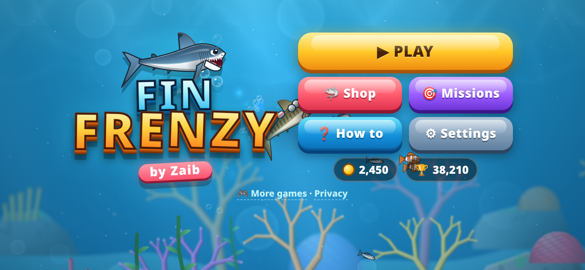
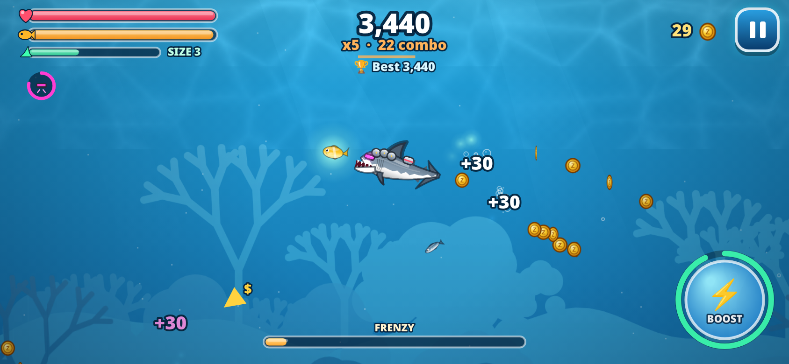

# 🦈 Fin Frenzy by Zaib

A shark arcade game for mobile and desktop browsers. Eat fish to grow, keep your hunger bar full, chain combos into a Frenzy, and take on bosses in five ocean zones.

**Play:** https://zaibgames.com/fin-frenzy/

## Features
- **5 zones:** Coral Reef, Shipwreck Bay, Arctic Ice, Deep Sea and The Abyss (glowing creatures in the dark)
- **25 levels** with a different goal in each, a **boss** at the end of every zone (King Crab, The Iron Tide submarine, Frost Narwhal, Giant Squid, Abyss Angler), and an **Endless** mode for each zone that saves your best score
- **Grow by eating:** food chains, combos, Frenzy mode, Gold Rush, chests and coins
- **6 sharks** to unlock and upgrade: Reef, Hammerhead, Mako, Tiger, Great White, Megalodon
- **Gadgets:** Jetpack, Laser Visor, Coin Magnet, Armor Plates, Big Belly, Frenzy Charm. Each has 5 upgrade levels.
- **Power-ups:** Magnet, Bubble Shield, Jet Boost, Laser, Mega Bite, Heal, Gold Rush
- **Missions** that pay coins, a shop, Lucky Shell revives, Power Pearls and 3-star ratings
- Graphics are all drawn in code: light rays, caustics, parallax, bubbles, particles, depth fog
- Music and sound effects are generated in the browser (WebAudio)
- Progress is saved in your browser (localStorage)

## Controls
- **Touch:** drag anywhere to steer with a floating joystick (or turn on follow-finger mode in Settings). Use the **Boost** and **Bite** buttons; double-tap also boosts. Auto-bite is on by default.
- **Keyboard:** WASD or the arrow keys to swim, Space/Shift to boost, X/J to bite, P/Esc to pause
- Landscape works best. Portrait is supported.

It's a single self-contained `index.html` with no dependencies.

Game by **Zaib** · [More games](https://zaibgames.com/)
